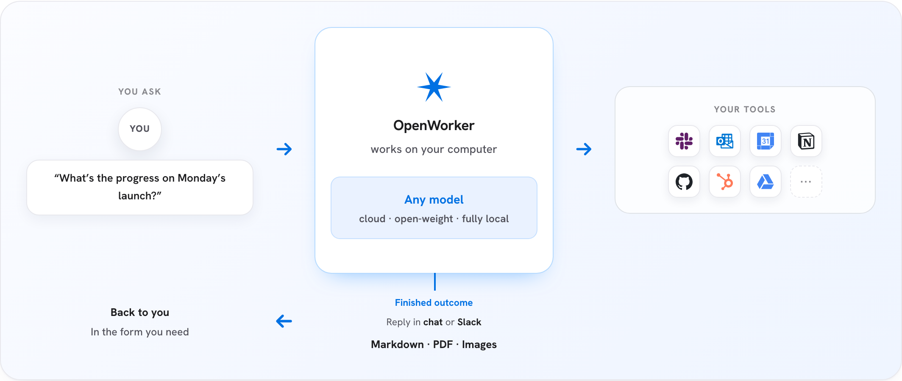

<h1 align="center">OpenWorker</h1>

<p align="center"><strong>A Desktop App for everyday work.<br>A Harness SDK to power your AI ideas.</strong></p>

<p align="center"><strong><a href="https://openworker.com">openworker.com</a></strong> · <a href="#use-the-openworker-desktop-app">Desktop App</a> · <a href="#build-agentic-apps-using-openworker-harness-sdk">Harness SDK</a> · <a href="https://github.com/andrewyng/openworker/issues">Issues</a></p>

<p align="center"><a href="https://trendshift.io/repositories/91434?utm_source=trendshift-badge&amp;utm_medium=badge&amp;utm_campaign=badge-trendshift-91434" target="_blank" rel="noopener noreferrer"></a></p>

Use the **OpenWorker Desktop App** to research, write, review code, and carry out tasks across the tools you already use. Or build your own agentic desktop and web apps with the **OpenWorker Harness SDK**.

Bring your choice of cloud or local models. Set permissions for your agents and decide which actions need your approval.

> This README mainly covers the **OpenWorker Desktop App**. For SDK setup, examples and architecture, see the [**OpenWorker Harness SDK README**](harness/README.md).

## Use the OpenWorker Desktop App

An AI coworker for your everyday work. Go from a request to a prepared brief, an organized folder, or a reviewed pull request.

It runs on your machine. Bring your own model key or run locally with Ollama, and choose which integrations it can access. Commands can run inside an [NVIDIA OpenShell](docs/openshell.md) sandbox. See [Governed by design](#governed-by-design) for its approval and safety controls.

[](https://openworker.com)

<a id="download"></a>

[**⬇ macOS (Apple Silicon)**](https://download.openworker.com/mac)
<sub>macOS 12+ · signed & notarized · auto-updates</sub>

[**⬇ Windows 10/11 (x64)**](https://download.openworker.com/windows)
<sub>builds are not yet code-signed, so SmartScreen will warn; signing is in progress</sub>

Open the app, add a model key (or point it at Ollama), and ask for something real.

The OpenWorker Desktop App is in open beta and supports automatic updates. [Issues](https://github.com/andrewyng/openworker/issues) welcome as we polish rough edges.

<a id="build-with-the-openworker-harness-sdk"></a>

## Build agentic apps using OpenWorker Harness SDK

Bring agentic capabilities to your own desktop app, web app or local utility. Build the product experience while OpenWorker handles the agent loop, tool calls, approvals, streaming and durable sessions.

Use the TypeScript SDK from npm, or embed the Rust engine in your application. Start with one agent. Add sub-agents, teams, OpenShell sandboxing and observability as your application grows.

```sh
npm install --save-exact @openworkerai/harness-sdk@0.1.0-beta.4
```

[**Explore the Harness SDK →**](harness/README.md) ·
[Desktop guide](docs/harness/guides/desktop.md) ·
[Web guide](docs/harness/guides/server.md) ·
[Build with Codex or Claude Code](skills/README.md)

## Desktop App use cases

Pick a coworker, point it at real work, get a finished deliverable:

- **Security review** - scan a codebase and its dependencies for real risk. Findings come from deterministic scanners (like semgrep) plus model reasoning; proposed fixes are re-scanned and diff-reviewed before you approve them - the fixer is never the only checker.
- **Cloud posture** - audit cloud configuration against common misconfiguration classes and draft the remediation plan.
- **Incident triage** - work a security or ops incident: gather context across your tools, draft the timeline, prepare the report.
- **Everyday work** - prep a customer call from your CRM and inbox, turn scattered notes into a shippable plan, produce documents and spreadsheets, keep your calendar and Slack threads handled.
- **Standing automations** - a morning brief, a weekly report, a watch over a channel - on a schedule, with full transcripts.

Specialist coworkers arrive with the tools, working style, and check-ins for one job already set up. Security coworkers ship first.

<a id="how-it-works"></a>

## How the Desktop App works

1. Tell the OpenWorker Desktop App the outcome you want - "prepare a customer brief," "untangle my calendar," "draft a report," "check where the release stands across Jira and GitHub."
2. It breaks the task into steps and works across your desktop, files, and connected apps.
3. Before anything consequential - sending a message, changing a calendar, running a command - it checks in and you approve or redirect.
4. You get the finished deliverable, not a to-do list.

The Desktop App uses a Python agent engine. The Harness SDK provides a separate Rust engine for applications you build.

Under the hood:

```text
┌────────────────────────────────────────────────┐
│              OpenWorker Desktop App            │  native shell + GUI
├────────────────────────────────────────────────┤
│           local agent server (Python)          │  engine · tools · connectors - built on aisuite
├───────────────┬────────────────┬───────────────┤
│  your files   │   your tools   │  your model   │  everything runs with your keys,
│  & terminal   │ 25+ connectors │  any provider │  on your machine
└───────────────┴────────────────┴───────────────┘
```

## Governed by design

Governance is the architecture, not a plugin - the agent can't grant itself new permissions, and no prompt can talk it past a gate. Four tiers, all in this repo:

1. **Hard floors.** A set of dangerous and irreversible operations is human-only, always. No mode - including full auto-approve - lowers these floors; they always escalate to you.
2. **A ladder of earned autonomy.** Actions are approval-gated by default. One-off approvals can graduate into standing rules, then into config allowlists - each step explicit, visible, and revocable. In auto-approve mode a reviewer model lets routine actions through and escalates anything it isn't sure about to you; repeated denials trip a circuit breaker that pauses the reviewer and hands control back. Reviewer verdicts are judgments, not guarantees - the floors and the audit trail are what backstop them.
3. **An audit trail that answers "who did this, and why?"** Every tool call is recorded with its approval provenance - auto-approved, user-approved, or denied, with the reviewer's reasoning attached - and persisted with the conversation.

4. **A sandbox for what the agent runs.** A session's commands and file tools can run inside an [NVIDIA OpenShell](https://github.com/NVIDIA/OpenShell) sandbox — one Linux container per agent that holds the session's folders and nothing else: no keys, no other files, and only an allow list of network hosts. The agent loop, the model keys and the connectors stay outside the wall, so a prompt injection that reaches a command lands in a box that holds nothing. On a Mac the same protection is available with nothing to install, through the sandbox built into macOS; on Windows, through a hidden local account that cannot see your profile. See [docs/openshell.md](docs/openshell.md), [docs/macos-sandbox.md](docs/macos-sandbox.md) and [docs/windows-sandbox.md](docs/windows-sandbox.md).

Unattended runs never self-approve: their asks park in an inbox until a human answers. Found a vulnerability? See [SECURITY.md](SECURITY.md).

## What it can do

- **Produce real deliverables** - documents, spreadsheets, reports, and web pages land as files you can open and share.
- **Work from Slack** - mention `@OpenWorker` in a channel; a session opens on your desktop, the work happens with your tools, and the answer comes back as a thread reply.
- **Use your everyday tools** - 25+ integrations including GitHub, Slack, Jira, Notion, Linear, HubSpot, Outlook, monday.com, Gmail, and Google Calendar, plus your **terminal and local files**. Any tool reachable over [MCP](https://modelcontextprotocol.io/) plugs in too, with per-tool control.
- **Run on a schedule** - automations for recurring work: a morning brief, a weekly report, a standing watch over a channel. Runs land in the app with full transcripts.
- **Run commands in a sandbox** - turn on [NVIDIA OpenShell](docs/openshell.md) for a machine and every agent's shell and file tools run in their own Linux container, with the session's folders and an allow-listed network and nothing else; on a Mac, the [built-in sandbox](docs/macos-sandbox.md) does the same with nothing to install, and on Windows a [hidden local account](docs/windows-sandbox.md) does.
- **Ask before acting** - writes, sends, and shell commands are approval-gated, with an optional auto-approve mode that still escalates anything uncertain - see [Governed by design](#governed-by-design).

## Bring your own model

In the OpenWorker Desktop App, model access is yours: pick a provider, paste your key, switch anytime. Supported out of the box:

**OpenAI · Azure OpenAI · Anthropic · Google Gemini · BytePlus Ark · Volcengine Ark Agent Plan · Atlas Cloud · Inkling (Thinking Machines) · GLM (Z.ai) · DeepSeek · Kimi (Moonshot) · Qwen · MiniMax · Mistral · Grok (xAI) · Solar (Upstage) · Cohere** - plus aggregators **OrcaRouter**, **OpenRouter** and **Hugging Face Inference Providers**, open-weight models via **Together**, **Fireworks**, **Cerebras** and **SiliconFlow**, and fully local models via **Ollama**, llama.cpp, vLLM, LM Studio, Jan, Docker Model Runner or mlx-lm.

A curated model list marks what we've verified for tool-calling work. Adding any model string works at your own risk.

Azure OpenAI uses your own resource: paste its endpoint and key (or set `AZURE_OPENAI_API_KEY`), then add your deployment names as models — on Azure the model id is the deployment name.

Another OpenAI-compatible server — a gateway, a proxy, a vendor not listed? In **Settings ▸ Models & Keys**, the **Add an OpenAI-compatible provider** box at the end of the API-keys group takes a name, its endpoint and key; it becomes its own card, and its models are selected as `<prefix>:<model-id>` (the prefix is derived from the name). Type the model ids, or fetch them from the server when it lists them.

OpenRouter comes two ways under **Settings → Models & Keys**: **OpenRouter** (API
keys) takes a key you paste; **OpenRouter account** (Subscriptions) signs you in
through the browser and uses your OpenRouter credits — the key OpenRouter issues
stays on this computer. On a remote backend choose **Use a manual code** and paste
the code OpenRouter shows. Each card is its own provider with its own models, so
disconnecting the account never falls back to a pasted key. To revoke the issued
key on OpenRouter's side, use the **Manage or revoke keys on OpenRouter** link.

<a id="privacy"></a>

## Desktop App privacy

The OpenWorker Desktop App is local-first. Everything lives on your machine: the agent loop, your conversations, connector tokens, and model keys - all in the app's local secret store. The only cloud piece is a small service that brokers OAuth handshakes for connectors. You can always use the App without signing-in - use the connectors via manually-created credentials/API-keys.

<a id="run-from-source"></a>

## Run the Desktop App from source

Prerequisites: Python 3.10+, Node 20+, and (for the desktop shell) the Rust toolchain via [rustup](https://rustup.rs/).

```shell
git clone https://github.com/andrewyng/openworker
cd openworker

# 1. One-time bootstrap - creates the Python venv at .venv
#    (on Windows, run from Git Bash or WSL)
bash packaging/setup_dev_env.sh

# 2. Start the local agent server
.venv/bin/python -m coworker.server.run --cwd ~/some/project --port 8765
#    (Windows: .venv\Scripts\python -m coworker.server.run ...)

# 3. In a second terminal, start the UI
cd surfaces/gui
npm install
npm run dev        # browser UI on the Vite dev port
```

The standalone server creates a per-launch token at
`<state-dir>/sidecar-8765.token`; Vite reads that user-only file when it starts.
For direct API calls, send its value in the `X-OpenWorker-Token` header. The
desktop app uses an in-memory launch token instead and never writes it to disk.

To run the full desktop app instead of the browser UI, replace step 3 with `npm run tauri dev` (from `surfaces/gui/`) - the Tauri shell launches the window and supervises the server itself.

Tests: `.venv/bin/pytest` (server), `npm test` and `npm run e2e` in `surfaces/gui` (GUI unit + hermetic end-to-end). Desktop bundles are built with `packaging/build_dmg.sh` / `packaging/build_windows.ps1`.

## Repository layout

| Directory | What's in it |
|---|---|
| `coworker/` | Python backend - agent engine, model providers, connectors, MCP client, memory, automations |
| `harness/` | Rust agent runtime, Rust/TypeScript SDKs, service and SDK examples |
| `surfaces/gui/` | Desktop app - React UI + Tauri shell that supervises the server |
| `stt/` | Speech-to-text sidecar (Rust) for voice input |
| `packaging/` | Installer builds (macOS DMG, Windows), auto-update manifest, dev bootstrap |
| `docs/` | Design specs and decision logs |
| `tests/` | Backend test suite |

## Built on aisuite

The OpenWorker Desktop App's engine is built on [**aisuite**](https://github.com/andrewyng/aisuite), a lightweight Python library providing a unified chat-completions API across LLM providers and an agents layer with tools, toolkits, and MCP support. If you want to build your own agent harness rather than use ours, start there; this repo is a working reference for what aisuite can carry.

OpenWorker was originally developed inside the aisuite repository before moving to its own home here; thanks to the aisuite contributors whose work it builds on.

## Contributing

Contributions and bug reports are welcome - open an [issue](https://github.com/andrewyng/openworker/issues) or a pull request. The app updates itself, so fixes reach installs quickly.
For any PR, please attach screenshots of what was broken and how it is fixed now. We will shortly add features that you can contribute to.
Please note that we are actively developing based off a internal list and goal, so we may not approve PRs that add features that are already under-development or deviates from our vision.

## License

MIT - see [LICENSE](LICENSE).
