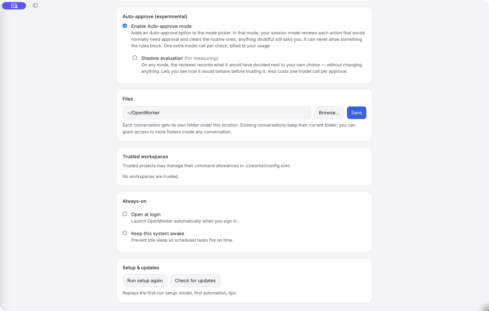

# Approvals and Auto-approve

Choose how proposed actions are reviewed before a coworker uses its tools.

Use the mode menu in the composer. **Ask for approval** is the default starting mode; check it explicitly for an existing conversation because your earlier choices and saved permissions can affect behavior.

## Understand the modes

| Mode | How to use it |
|---|---|
| Discuss | Read and discuss without edits or command execution. Use it to explore a request before acting. |
| Ask for approval | Review actions that require a decision. Reads and actions already allowed by rules can run without a new card. |
| Auto-approve | Let the automatic reviewer clear eligible actions; decisions it cannot safely clear still reach you. |
| Bypass approvals | Skip ordinary approval prompts without a reviewer. Some protected actions still require a human; this is not the same as Auto-approve. |

Available modes depend on the build and configuration. If Plan is offered, it is for read-only investigation and a proposed plan before implementation. A mode does not grant a missing connector credential or make a sandbox-denied host reachable.

## Review an approval card

Check the tool, its arguments, destination and scope. A request to write a file is different from a request to execute a script; a local change is different from sending or publishing it.

Approve an action when it matches your task. Otherwise decline it and explain what should change. If the card offers a lasting permission, consider whether you want to allow future calls too; don't select it merely to finish one task.

## Enable the automatic reviewer

In **Settings → General**, find **Auto-approve (experimental)** and enable **Auto-approve mode**. Then choose **Auto-approve** in the conversation's mode menu. Enabling the setting makes the mode available; it does not mean every conversation has switched to it.

*The reviewer is enabled on this installation. The screenshot does not imply it is enabled by default.*

## How a tool call is reviewed

Permission rules first decide whether a call is allowed, blocked or needs a decision. In Auto-approve mode, an eligible call that still needs approval can be reviewed against the task, conversation and available policy context. Clear approvals can proceed; uncertainty or escalation returns control to a human. The reviewer cannot turn a rule-level block into permission.

Not every tool call needs a separate reviewer-model request. Reads or supported low-risk actions can be allowed by rules first. Model reviews add latency and model usage when they occur. The setting in the captured build uses the session model for its reviewer.

A model's verdict is a judgment, not a security guarantee. Keep the task boundaries, account permissions and [sandbox restrictions](sandbox.md) appropriate even when the reviewer is enabled.

## Try shadow evaluation

**Shadow evaluation** records what the reviewer would have decided alongside your own decision without using that verdict to approve the action. It is useful for evaluating the reviewer before relying on it, and can still incur model usage.

## When you are away

Unattended work can send pending questions and approvals to the Inbox. A parked action is waiting, not approved. Remote work also needs a connection when you return to answer it.

Review [Automations](automations.md) before expecting a scheduled task to run without interruption. Approving one action does not automatically authorize every future action or recurring run.
