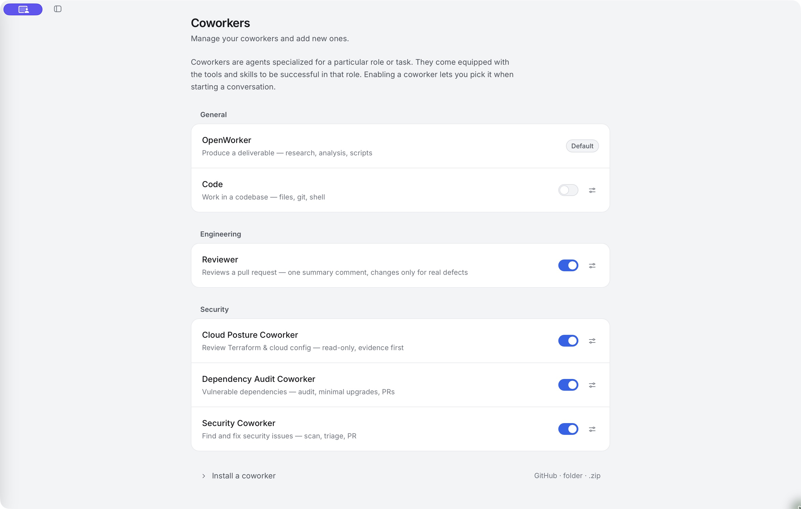

# Choose a coworker

Pick an agent whose tools and instructions fit the work you want to do.

The default **OpenWorker** coworker is a good starting point for research, analysis, documents and other daily work. Specialist coworkers bring a more focused workflow. You don't need to install a separate application for each one.

<div class="app-screenshot screenshot-coworkers">

[](images/coworkers.jpg)

</div>

*Installed and enabled coworkers appear in the new-conversation picker. The screenshot shows this installation's choices, not a requirement to enable every coworker.*

## Find and enable a coworker

Open **Settings → Coworkers**. Read the description and use **Configure** to inspect its capabilities and recommended connections. Enable a coworker you want available, then select it when starting a **New session**.

| Coworker | Use it for |
|---|---|
| OpenWorker | Everyday tasks, research, analysis, scripts and deliverables |
| Code | Work in a code repository, including changes and verification |
| Security Coworker | Investigating application-code and secret findings |
| Dependency Audit Coworker | Reviewing vulnerable dependencies and focused upgrades |
| Cloud Posture Coworker | Reviewing infrastructure configuration and cloud exposure |

Availability varies by installation. An installed specialist may need to be enabled before it appears in the picker. Internal or experimental roles are not automatically part of a public release.

## Give the coworker the right context

Choose a working folder when the role requires one. Enable only the connected services needed for the task. A recommended connection explains what it unlocks; it is not consent to use every action on that service.

Start with an outcome and an explicit boundary:

```text
Compare the three proposals in this folder. Recommend one, explain the
trade-offs, and save a short decision brief. Don't contact the vendors.
```

For Code and security work, include the repository, expected result and how changes should be verified. See [Coding coworker](coding.md) and [Security coworkers](security.md).

## Delegation and teams

Some coworkers can delegate work to child agents. You may see delegated activity or linked worker conversations as part of a larger task. Team-capable roles can also coordinate through a board and staffing workflow.

These are capabilities of the selected coworker, not a requirement for every task. Review any team proposal and the access requested for its workers. Delegation does not make an agent's message equivalent to your approval.

## Install a coworker you trust

**Install a coworker** accepts supported GitHub, local-folder or ZIP sources. Inspect the role's instructions, tools, skills and requested connections before enabling it.

Coworker instructions influence an agent that can act with your granted access. Treat a third-party role as something you must trust and understand, even when its package contains instructions rather than executable plugin code.

For reusable instructions without a new role, see [Skills and memory](skills-memory.md).
