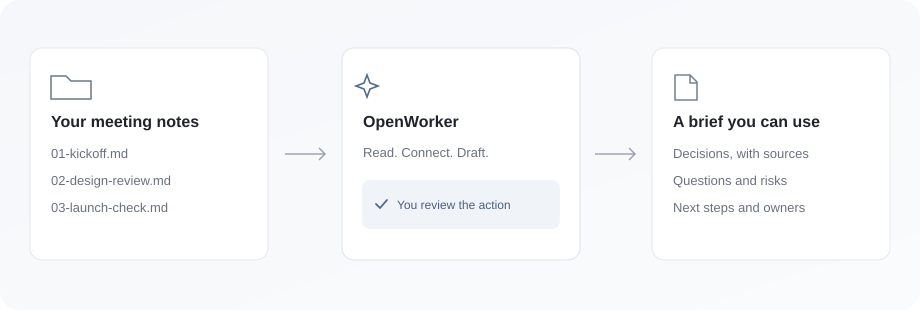

# OpenWorker Desktop

Turn a request into finished work, using your files and the apps you already use.

OpenWorker runs on your computer and works with the context you share. Ask it to prepare a brief, investigate a codebase or finish a task across connected apps. It reads, uses tools and creates files while you follow its progress and decide which actions to allow.

## Start with work you already have

Give OpenWorker an outcome and the material it needs. You can start with a single folder; connected apps are optional.

- **Make sense of information.** Compare documents, pull together research and turn scattered notes into a clear recommendation.
- **Move a project forward.** Explore code, investigate a failing test or prepare changes you can review.
- **Work across your apps.** Connect services such as GitHub, Slack or your calendar, then ask for work that brings them together.

For a first try, [create a meeting brief from three sample notes](first-task.md). You'll choose a model, give access to a folder, review a proposed action and find the finished file.

## Explore the app

- [Connect a model](models.md), use [local inference](local-models.md), or [dictate requests with local transcription](voice.md).
- [Choose a coworker](coworkers.md) for everyday work, [coding](coding.md) or a [security investigation](security.md).
- [Connect your apps](connectors.md), teach a [reusable skill](skills-memory.md) or [schedule recurring work](automations.md).
- [Add a remote machine](machines.md) and [choose where a conversation runs](run-location.md).
- Review [approval modes](approvals.md), [sandboxing](sandbox.md) and [where your data goes](privacy.md).

## Give it a task, then work together

1. **Choose a model.** Connect a cloud provider with your own key, or use a model running on your hardware.
2. **Choose the context.** Share the files or connected services needed for this task.
3. **Describe the outcome.** Say what you want created, where it should go and any boundaries to follow.
4. **Review and refine.** Follow the activity, respond to approval requests and continue in the same session to improve the result.

You can return to a saved session rather than explaining the task again. Check important conclusions against the source material and open the generated files before sharing them.

## Choose how much autonomy to give

For your first task, use **Ask for approval**. Reads can happen without interrupting you; edits and commands can bring up an approval request. Review the proposed action and its arguments before allowing it. Previously saved permissions can affect when a request appears.

**Auto-approve** uses a model to review actions and passes uncertain decisions to you. It reduces interruptions, but a model's judgment is not a guarantee. You can start with manual review and change the mode when you understand the workflow.

Optional sandboxing can isolate supported commands and file tools using NVIDIA OpenShell or a supported platform sandbox. It is separate from approval mode and must be configured; choosing a folder alone does not create a sandbox.

## Use your choice of model

Set up providers in **Settings → Models & Keys**. Cloud providers need your credentials and may charge for model usage. Local model servers let you use models on your own hardware; choose one that supports tool calling for tasks that read or write files.

Your conversations and app settings are stored locally. When you use a cloud model, the task context sent to that model—including file contents the agent reads—is processed by that provider. Connected services receive the requests you make through them.

Looking to build your own AI application?

This documentation is for using the OpenWorker Desktop App. The [OpenWorker Harness SDK](https://openworker.com/docs/sdk/) is for developers building their own desktop or web applications with agents, tools and durable sessions.

