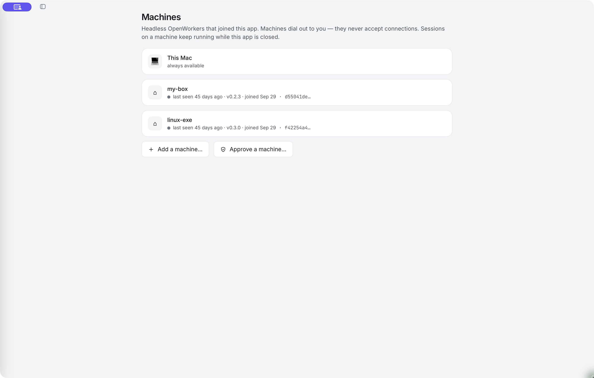

# Add a remote machine

Run agents on a VM or another computer while using the Desktop App as your control surface.

A joined machine runs its own OpenWorker process and stores its conversations and files locally. It connects back to the Desktop App. You can start work there, follow the conversation and answer approvals from your laptop.

<div class="app-screenshot screenshot-machines">

[](images/machines.jpg)

</div>

*The captured installation has two offline test machines. A listed machine must be online before you can start or interact with its remote work.*

## Prepare the machine

Use a supported Linux or macOS machine that you control, with disk space, network access and the tools your task needs. On that machine, install the headless OpenWorker program:

```sh
curl -fsSL https://openworker.com/install.sh | sh
openworker machine status
```

The installer chooses the supported package for that system and explains any PATH or prerequisite steps. A VM subscription or cloud account is not created by this command; provision and secure the machine separately.

## Make the controller reachable

The remote machine makes an outbound connection to your Desktop App. It still needs a network path to the app's listening address. The app normally uses a loopback address, which another computer cannot reach directly.

In **Settings → Machines → Add a machine…**, follow the reachability instructions. An SSH reverse tunnel or an appropriately configured private VPN/tailnet are supported approaches. Use the actual port shown in the card; don't assume it is always 8765.

<details>
<summary>Example: an SSH reverse tunnel</summary>

If the app is using port 8765, run this on your desktop and leave it running:

```sh
ssh -N -o ServerAliveInterval=15 -R 8765:localhost:8765 you@your-machine
```

On the remote machine, the forwarded controller appears at `127.0.0.1:8765`. Adjust both sides to the port displayed by your app. A tunnel can end when either computer sleeps or reboots; it is not a substitute for persistent connectivity.

For a private VPN, follow the app's opt-in listening instructions and use the private address. Do not expose the controller directly to the public internet merely to make enrollment work.

</details>

## Enroll it

Opening **Add a machine…** creates a short-lived, one-use enrollment command. Run that command on the intended machine and verify its displayed fingerprint against `openworker machine status` there.

```sh
openworker join http://127.0.0.1:8765/j/<one-time-token> --name=my-machine
```

The command above is a shape example; copy the real command from your app. Treat it as a credential while it is valid. Don't put enrollment links in screenshots, source control or bug reports.

The card can offer **Provision with my model keys**. Leaving this selected copies credentials to the joining machine, encrypted to that machine's identity. Select it only when you trust the machine and want it to hold those credentials. You can configure access later instead.

## Give it model and tool access

The remote agent uses the remote machine's model providers. Use its **Keys** controls or select that machine in Settings to manage the connections available there. Changing a key on the laptop does not automatically rotate an already deployed copy; check the remote deployment status.

Connector transfer is capability-dependent. Some account types need their own sign-in. See [Connect your apps](connectors.md#on-another-machine).

## Keep it running

On a Linux machine, the service command configures the supported user service:

```sh
openworker machine service install
```

Check its instructions for running across logouts. On a systemd machine, user lingering may require an administrator. Keep any SSH tunnel or VPN path available as well.

An already running remote agent can continue while the Desktop App is closed. Actions waiting for your approval can still pause until you reconnect and respond. New remote requests require a working connection.

Next: [Choose where work runs](run-location.md).
