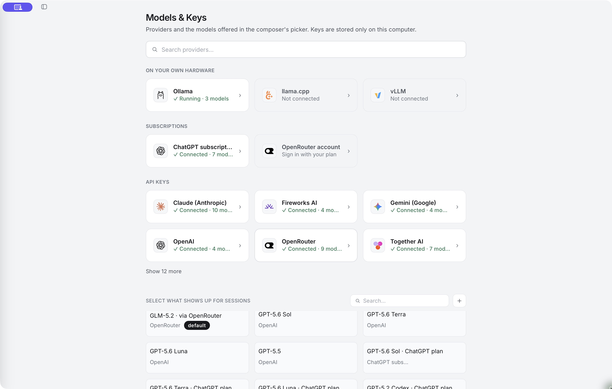

# Connect a model

Use your choice of provider, account or compatible model server in OpenWorker.

Open **Settings → Models & Keys**. Providers are grouped into models running on your hardware, supported account subscriptions and API-key providers. Use **Search providers…** or expand the remaining providers to find yours.

*Captured in the Desktop App on macOS. Provider availability and the model list can change; open the image for a closer look.*

## Connect with an API key

1. Select your provider, such as Anthropic, OpenAI, Gemini, OpenRouter, Together or Fireworks.
2. Enter its API key in the provider's setup form. Keep keys out of conversation messages.
3. Use the test/connect action in the form and resolve any error before continuing.
4. Select the models you want available in conversations.

The provider supplies and bills model access. Connecting a key is separate from signing into an OpenWorker account. A connected provider is not a guarantee that every model it offers supports tools, images or PDFs.

## Use a supported account connection

Some provider cards let you sign in through a browser instead of pasting an API key. Follow the flow offered by that card. An account connection and an API-key connection are separate identities, even when both use the same provider.

For example, **OpenRouter account** uses the browser account flow, while **OpenRouter** accepts a key. Check the provider and account shown on the model you select. Subscription support depends on the provider and your installed build; a subscription does not imply unlimited use through every API.

## Add a custom endpoint

For a vendor or company gateway that implements a supported OpenAI-compatible API, find **Add an OpenAI-compatible provider** in the API-key group. Supply a name, the endpoint and the credential your gateway expects. Fetch the model list when the endpoint supports it, or enter its model IDs.

For Azure OpenAI, use its provider form with your resource endpoint and key. Model IDs are your Azure deployment names.

Compatibility still matters. Test both a short reply and a simple tool task before relying on a custom provider for agent work. A successful text reply alone does not prove tool calling works.

## Choose a model for a conversation

The model picker in the composer uses the models enabled in **Models & Keys**. Choose a model before sending a request. You can change the selection for subsequent messages; earlier usage remains associated with the model that produced it.

Open a model's settings to adjust the options it supports, such as **Longest reply**, thinking/effort and **Auto-compact**. Options vary by model and server. Increasing a reply limit does not increase the model's context window.

The provider is connected, but my model isn't listed

Check **Select what shows up for sessions** and use **Pick a model…** to add it. Confirm the model ID and account access. For a remote conversation, check the [remote machine's providers](run-location.md), rather than only the providers on your laptop.

Next: [Run local models](local-models.md) or [try a task with your connected model](first-task.md).
