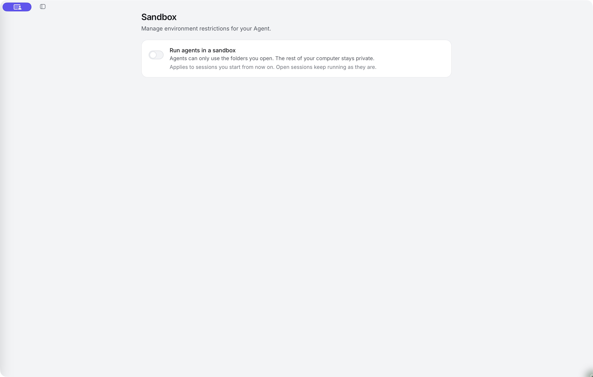

# Sandbox tool execution

Restrict supported commands and file tools to the environment you choose.

Open **Settings → Sandbox** for the selected machine. **Run agents in a sandbox** enables the configured provider for new sessions once its setup checks pass. Existing sessions keep their execution configuration; start a new conversation to use a changed sandbox setting.

*The switch is off in this capture. Opening this page does not turn sandboxing on.*

## Choose an execution boundary

| Option | Where it fits | Setup |
|---|---|---|
| macOS sandbox | Native execution on a Mac | Uses the operating system's sandbox; no container runtime required |
| Windows sandbox | Native execution on a supported Windows PC | One-time administrator setup for restricted local accounts and network rules |
| NVIDIA OpenShell | Linux container-based execution; also usable on supported Macs with Docker | OpenShell, a working container runtime and the setup checks offered by the app |

Available choices depend on the machine and build. [Native sandboxing](native-sandbox.md) and [OpenShell setup](openshell.md) explain the differences.

## What is inside and outside

Inside the execution boundary are the supported command and file tools, the processes they start and the session folders they can access. Filesystem grants can be read-only or read-write.

The agent loop, model connections, approval system and service connectors stay outside that tool sandbox. An email connector can still send through its account if your request, its permissions and the approval rules allow it. Restricting shell networking does not disable every external connection the app can make.

## Network and credentials are explicit choices

Review allowed sites, network mode, toolchains and any shared logins. A network-open sandbox can still restrict files; an allowlist restricts destinations but does not make all allowed traffic harmless.

Model keys and connector tokens are not automatically copied into the sandbox. Credentials you deliberately share for command-line tools are an exception, and a shared folder can itself contain sensitive files. See [Share logins deliberately](native-sandbox.md#share-logins-deliberately).

## Verify a new session

After setup, start a fresh conversation and inspect its sandbox indicator. Check the folders and allowed sites. If setup cannot establish the configured boundary, resolve the error rather than silently switching to unrestricted execution.

Use [Ask for approval](approvals.md) while verifying the workflow. Sandboxing limits the tool's reach; approval review decides whether the proposed action should happen.
