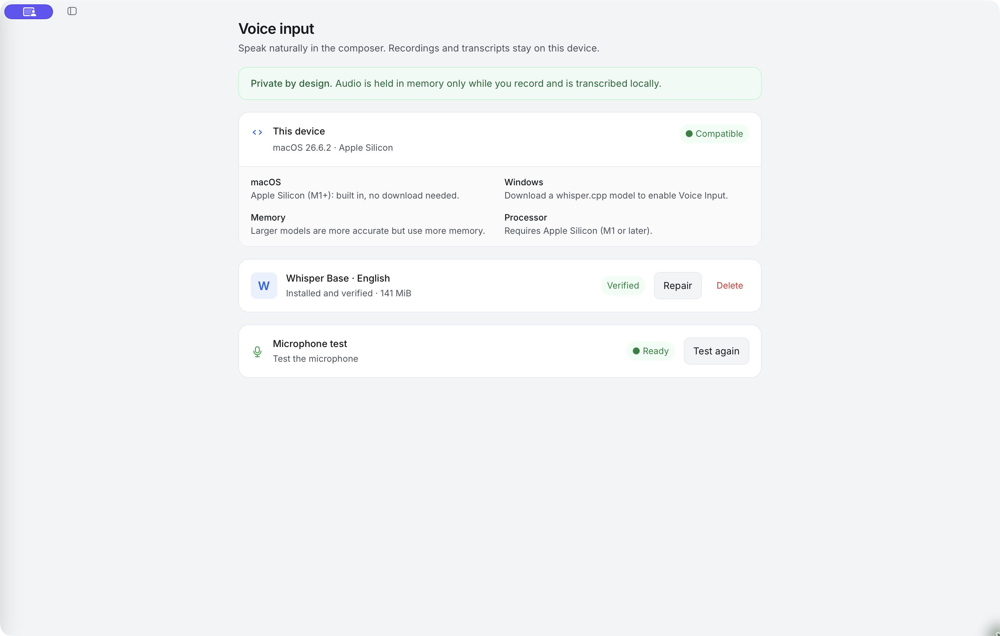

# Voice and local transcription

Speak a request and turn it into editable text without sending the recording to a cloud transcription service.

Open **Settings → Voice input** to check compatibility, prepare the local model and test your microphone. Voice input is a Desktop App feature; the browser-only interface does not provide the native setup controls.

*This Mac already has the English voice model installed and verified. Your setup screen may offer Download instead.*

## Prepare voice input

1. Check **This device** for compatibility and any explanation shown there.
2. If the voice model is missing, select **Download** and let verification complete. The current Whisper Base English model is about 141 MiB.
3. Select **Test the microphone**. Grant microphone access through the operating system when prompted, speak a short sentence and stop the test.
4. Review the resulting text and check that the screen reports **Ready**.

On supported Apple Silicon Macs, the app can be ready without a separate download. Supported Windows builds offer a whisper.cpp model download. Intel Mac voice input is not currently supported; the device check is the authority for your machine. A downloaded model needs disk space, and transcription uses local processing resources.

## Dictate a message

Open a conversation and use the microphone control in the composer to start recording. Stop when you've finished speaking, then review the transcription in the message box. Correct names, numbers and instructions before sending it to the coworker.

Dictation prepares a normal message; it does not grant additional tools or permissions. Approval mode still applies when the coworker acts on that message.

## What stays local

The native transcription engine processes audio locally. Recordings are held in memory for the dictation operation rather than saved as an audio archive. The recognition model is kept on disk so it can be reused.

Once you **send the transcribed text**, it becomes conversation content. If that conversation uses a cloud model, the text can be sent to that provider along with the rest of the request. Local transcription and local inference are separate choices.

This feature is for dictating requests in the composer. It is not a meeting recorder or a general audio-file transcription workflow.

If voice input isn't working

- Check the device compatibility explanation and microphone permissions in system settings.
- If verification fails, use **Repair** and check available disk space and download connectivity.
- If the test reports no speech, check the selected system input device and try a short English sentence.
- If the microphone button asks you to configure voice input, return to Settings and complete the readiness test.

Avoid deleting a working model as a first troubleshooting step; it will need to be downloaded again if your build requires it.

