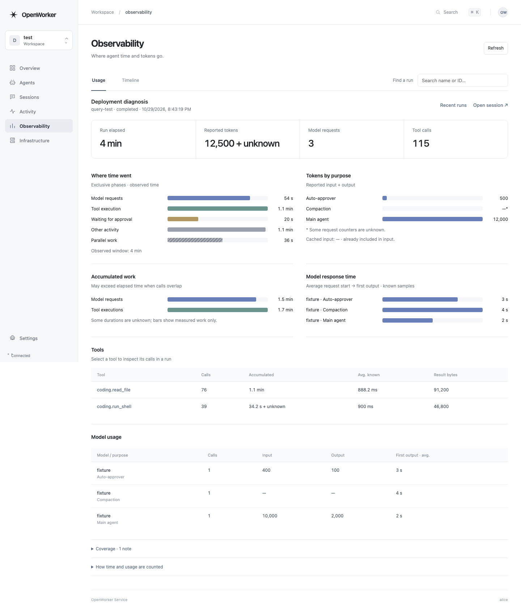
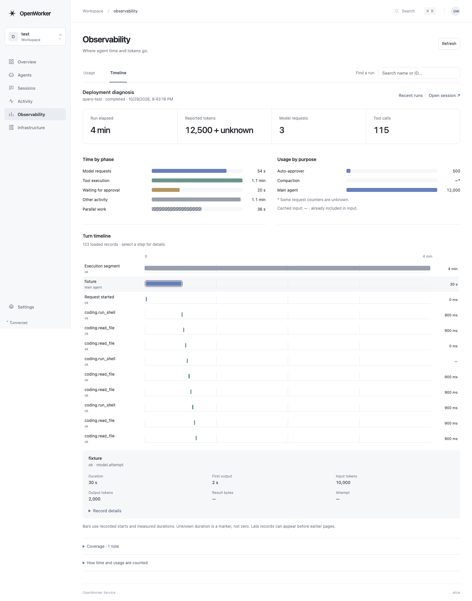
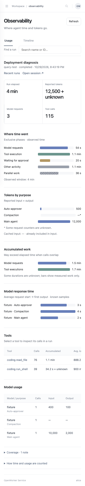

# M4 management UI screens

Captured from the real UI/Rust API with separate local PostgreSQL databases.
The names, timings and usage are deterministic test fixtures, not customer data
or measurements of a live model. The final read-only Linux UI container was
qualified at desktop and narrow widths.

[Qualification report](../observability-m4-local-20261029.json).

## Grouped usage

## Turn timeline

## Narrow layout

