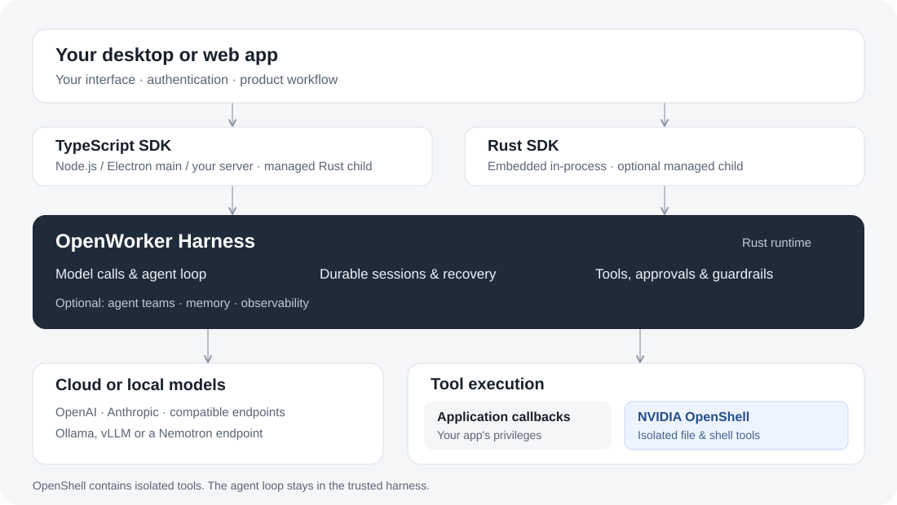

# How OpenWorker fits into your app

Your application owns the product experience; the harness runs the agents.

The app chooses models, registers tools, identifies users and decides which
sessions they can access. OpenWorker coordinates model calls, tools, approvals,
conversation state and delegated work.



## Agent, session, turn and model call

| Concept | Meaning |
| --- | --- |
| Agent | A reusable definition: instructions, model, tools and policy. |
| Session | One durable conversation, its execution state and attachments. |
| Turn / run | Work triggered by a submitted message; it can include several model calls and tools. |
| Model call | One request to a provider. Failed attempts and retries belong to that call's execution. |
| Tool | An application callback, built-in capability or MCP integration the agent is allowed to invoke. |

Reuse a session for follow-ups. Save its reference to recover it after restart.
Create a new agent identity when changing its immutable definition. A session is
not a user account: your application enforces ownership and access.

## Run inside your application

| Application | Where the harness runs |
| --- | --- |
| Rust app | Embedded in-process, with a helper when selected execution features require one. |
| TypeScript desktop app | Managed Rust child process; the UI talks to the trusted main process through IPC. |
| Node web app | Managed Rust child process alongside your server; the browser calls your application's API. |

The SDK starts and shuts down its managed process. SQLite keeps local execution
state. A persistent application-data directory or mounted container volume lets
sessions survive process replacement. A process is still needed to perform work;
closing your app does not leave an independent cloud agent running.

Follow the [Desktop](desktop.md) or [Web](server.md) guide for this setup.

## Connect to a shared service

```text
Browser or desktop UI
        │ your application's authenticated API
Application server
        │ OpenWorker service API
API nodes ───────── PostgreSQL execution state
        │
Agent workers ───── model providers
        │
Execution environment / OpenShell sandbox
        └─ ToolRunner → files, processes and network
```

API nodes accept work; workers execute the agent loop. Durable state supports
recovery on another worker. Recovery reconciles uncertain tool outcomes instead
of assuming an interrupted write failed. The execution environment has its own
lifecycle; worker recovery alone does not recreate a lost workspace.

A **RuntimeProfile** describes the execution provider, resources and permissions.
An **environment** is a provisioned instance. Authorized sessions can share one
instance, or use independent environments. Shared agents must coordinate paths,
Git worktrees and server ports. See [deployment options](deployment.md).

## Know where a tool executes

Built-in tools routed through OpenShell execute inside its sandbox. Your Node or
Rust callbacks execute in your application process. Adding a tool name or a
workspace directory does not create an isolation boundary for arbitrary code.
[OpenShell](openshell.md) supplies execution isolation; [approvals](alignment.md)
and [guardrails](guardrails.md) add application decisions around that work.

## Add recording when you need it

Execution state is required for running and recovering agents. Observability
recording is optional and uses its own database configuration. Execution and
recording can use the same PostgreSQL server or separate servers. Exporting to
Langfuse or an OpenTelemetry collector is another independent option.

Metadata is enough to show latency and usage. Turn on content capture deliberately
when your product needs it. See [observability](observability.md).
