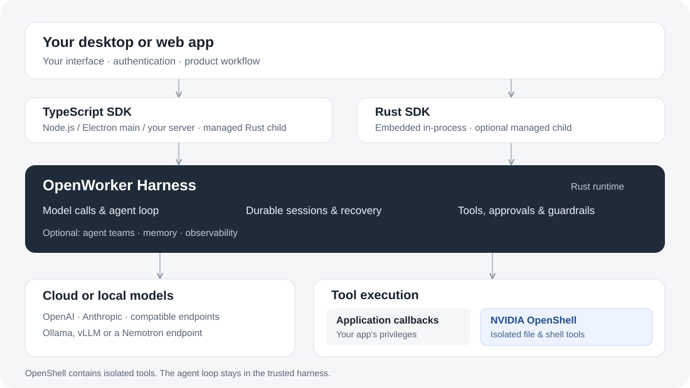

# Build your product. OpenWorker handles the agents.

Build apps that put agents to work on complex tasks.

Create an autonomous coding agent, a support agent that investigates and resolves
issues, or a team that coordinates a workflow across your systems. OpenWorker
Harness SDK handles model calls, tool execution, delegation and durable sessions
so you can focus on your product experience.

## Choose a track

- **[Build a desktop app](desktop.md).** Start with Code Atlas: select a code directory and stream an explanation. Then add tools and delegation for more capable workflows.
- **[Build a web app](server.md).** Start with PDF Notes: upload a document and ask follow-up questions. Deploy the frontend and API together on Railway or your container platform.

The tutorials deliberately start small. The same SDK supports long-running work,
multiple agents and remote service deployments as your application grows.

## Add the capabilities your product needs

| Your product needs | Start here |
| --- | --- |
| Agents that act on your systems | [Application tools and MCP](tools.md) |
| Work split between agents | [Sub-agents and teams](subagents.md) |
| Conversations that survive restarts | [Sessions and recovery](sessions.md) |
| Images, PDFs and text files | [Attachments](attachments.md) |
| Control over actions and sensitive content | [Approvals](alignment.md) · [Guardrails and hooks](guardrails.md) |
| Visibility into latency, token usage and failures | [Observability](observability.md) |

Choose cloud or local models. Run the Rust harness in-process in a Rust application,
or as a managed child process through the TypeScript SDK. A browser talks to your
application server; credentials stay there.

## Understand the architecture

Use NVIDIA OpenShell to isolate configured tool execution. The harness coordinates
the agent outside that sandbox; application callbacks retain your application's
privileges. See [architecture](architecture.md) for the process and storage boundaries.

Start inside your app. Move to a shared service when you need independent worker
capacity and shared storage. [Deployment options](deployment.md) distinguishes
application hosting from experimental cluster setup.

See [versions and installation](releases.md) for published packages, Rust setup
and runtime compatibility.
