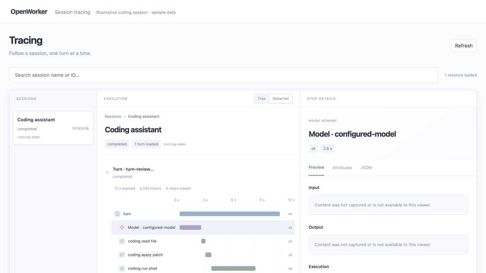

# Observe agent work

Inspect each turn's timeline, model usage, tools and spawned tasks. Keep recordings
locally, forward traces to a collector or Langfuse, or use both. These are separate
options; neither is needed to run an agent.

Recording, trace export and content capture are independently configurable.

## What you can inspect

| View | What it answers |
| --- | --- |
| Run search | Which session or run should I investigate? |
| Session turns | What happened after each user message? |
| Execution tree and waterfall | Which model call or tool took time, failed or retried? |
| Step details | What usage, outcome and permitted input/output belong to this step? |
| Child navigation | What did a delegated agent do? Open its session and return through the parent breadcrumb. |

The [management UI](../../../harness/service-ui/README.md) provides these views for
an authenticated service. Applications can also query recordings or embed the
optional trace viewer. No UI dependency is added to the core runtime.



*The tracing component with synthetic sample data. Content capture is off.*

## Record locally

Use a recording database separate from execution storage. Content capture is off;
timing, outcome, usage and identifiers are enough for most product dashboards.

```typescript
import {Harness} from '@openworkerai/harness-sdk';

const harness = await Harness.start({
  stateDir: '/absolute/private/app/state',
  recording: {
    database: {type: 'sqlite', path: '/absolute/private/app/observations.sqlite'},
    retentionDays: 30,
    queueCapacity: 1024,
  },
});
// Create/run your agent as usual; then query its accepted turn.
await harness.observability.flush(5000);
const turns = await harness.observability.listTurns({sessionId});
if (!turns.turns.length) throw new Error("No recorded turn to inspect");
const query = {sessionId, turnId: turns.turns[0].turn_id};
const timeline = await harness.observability.timeline(query);
const summary = await harness.observability.summary({...query, through: timeline.page.through});
```

Rust uses `Harness::builder().recording(RecordingConfig::sqlite(path))` and
`harness.observability().timeline(TraceQuery::turn(session_id, turn_id))`.
Enable Cargo feature `recording`; add `recording-postgres` for PostgreSQL,
`evaluations` for durable results, and `evaluation-export` for background score
delivery. `otlp` is a separate default feature; `default-features = false` removes
it alongside default guardrail/compliance implementations. No UI dependency is
added to the runtime. Standard packaged binaries include optional capabilities,
but recording, evidence and evaluation delivery remain disabled until configured.

For PostgreSQL use a second `connectionEnv` and schema under
`recording.database: {type: 'postgres', connectionEnv: 'OBSERVABILITY_DATABASE_URL',
schema: 'ow_observability'}`. The execution and recording connections may point to
the same server or different servers. Run the explicit Rust
`RecordingConfig::migrate_postgres().await` setup operation before startup.
Production connections verify TLS; `loopbackPlaintext` is only for local fixtures.

Turn-list cursors refer to execution events; timeline cursors refer to recording
rows. Follow `next_cursor` even if a bounded turn-list page contains no turns.
Timeline `through` aligns reads to a watermark, not a cross-request transaction.
A flush is a bounded barrier, not a guarantee that previous dropped records were
recovered. Check `health()` counters for drops, write failures and export failures.

## Export traces

```typescript
import {langfuseTelemetry} from '@openworkerai/harness-sdk';

const telemetry = langfuseTelemetry(
  'https://your-langfuse.example/api/public/otel',
  'LANGFUSE_AUTHORIZATION',
);
const harness = await Harness.start({ telemetry });
// The environment value is
// "Basic " + base64(publicKey + ":" + secretKey), stored only in the backend.
```

The helper selects Langfuse v4 trace acknowledgements and metadata-only capture.
For a standard collector, set `telemetry.endpoint` to its OTLP HTTP base URL and
use the default `otlp` acknowledgement mode. Do not install a second exporter over
the same event stream. Rust has the matching `TelemetryConfig::langfuse` helper.
See [storage and collector setup](../../../harness/observability/README.md).

Use [Langfuse's public API](https://langfuse.com/docs/api-and-data-platform/features/public-api)
for downstream analytics. Traces are best effort, not a billing ledger. Cached
input and reasoning tokens are subsets; never add them again to input/output.
Missing usage is unknown. Tool duration and result bytes do not imply exact token
cost per tool. Export failure must never trigger replay of a tool or agent turn.

## Inspect a turn and its children

Local SDK queries and `service.observability` share timeline/summary shapes. The
service checks access against execution storage before and after recording reads.
It authorizes every child independently; parent visibility grants no child access.

`children(query)` returns durable spawn links, including `child_turn_id` when the
first task was accepted. `subtreeSummary(query)` counts the root plus visible
spawned initial turns, bounded to 25 scopes. Cycles are deduplicated. Later inbox
turns remain separate. The response names the selected runs and any truncation;
concurrent tasks have no single wall elapsed duration.

The optional [trace viewer](../../../harness/trace-viewer/README.md) provides
Usage/Timeline views, model/tool groups, child navigation and basic score display.
Your app supplies an authorized browser adapter. Do not put SDK, database or
exporter credentials in the browser.

<details><summary>Advanced: evaluation records, delivery and audit evidence</summary>

These APIs store results supplied by your application. They do not run judges
or provide a cluster evaluation UI.

### Record evaluations

Enable `recording.evaluations: true`, then submit results from your app or evaluator:

```typescript
const recorded = await harness.observability.recordEvaluation(query, {
  id: 'quality-review-1', name: 'correctness',
  evaluator: {name: 'answer-check', version: '1', source: 'code'},
  status: 'completed', score: {type: 'boolean', value: true},
  createdMs: Date.now(), datasetCase: 'case-42', experiment: 'candidate-a',
}, modelSpanId);
```

Use a stable ID and original timestamp when retrying the same result. Identical
writes return the existing record; conflicts fail. Corrections append a new ID
with `supersedes` referencing the old result. `skipped` and `error` have no score.
Model evaluators may attach their own model/usage; it is not added to agent usage.
This feature records results; it does not run judges or incur model charges.

To deliver results automatically, configure `recording.evaluationSinks`:

```typescript
const evaluationSinks = [{
  name: 'langfuse', url: 'https://your-langfuse.example',
  authorizationEnv: 'LANGFUSE_AUTHORIZATION',
  includeExplanation: false,
}];
```

The separate durable queue retries scores with the same ID/name/timestamp, never
traces or original actions. Delivery depends on destination idempotency semantics;
unknown acknowledgements are not proof of failure. Lease/backoff survives restart.
A sink name binds to its configuration; use a new name for a different destination.
`maxPendingEvaluations` defaults to 10,000; delivered retained results do not use
pending capacity. `evaluationRetentionDays` defaults to 30 and pruning protects
undelivered rows. Keep the recording database to resume pending delivery. Shutdown
is bounded and may leave pending scores for the next host start. Scores without a
recorded trace target and skipped/error results remain local and are explicitly
counted as not exportable. Explanations are excluded remotely unless opted in.

For caller-controlled one-shot export, import `exportLangfuseScore` from
`@openworkerai/harness-sdk/evaluation-export`. It does not retry uncertain responses.
Choose automatic or caller-controlled delivery for each destination.

### Evidence and audits

Set `recording.evidence` only when content is needed: `userInput`, `assistantOutput`,
`toolArguments`, `toolResults`, and `maxBytes` (256–65,536). `evidence(query)` projects
selected committed events, applies best-effort secret redaction, and reports fields
omitted for size. It excludes failed-attempt deltas, hidden reasoning and blocked
output. Current-turn input is available; historical input is not reconstructed.
Execution event IDs are separate from recording cursors.

`evidenceJsonl` in the optional export subpath combines authorized timeline,
summary, evaluations and explicitly supplied content with a versioned manifest,
selection, watermark and checksum. It covers only supplied pages, not all history.
It includes no content unless the caller supplies it. Keep expected answers and
rubrics in your dataset keyed by `datasetCase`; never inject them into the tested
agent. Artifact revisions can be included through selected tool results or your
application's evidence records. Checksums do not establish completeness or
administrator-resistant integrity.

Use the included session/turn/event references and configuration digests to join
existing [compliance records and SIEM delivery](compliance.md). Compliance records
remain the authority for approvals and effects; traces and evaluations are not
proof of compliance. A metadata reader is not a content auditor. In server apps,
authorize evidence access separately before returning it, and keep database/host
APIs in the trusted backend. The service's existing compliance content permission
continues to control audit reads. Cluster experiment/review tooling comes later.

</details>
