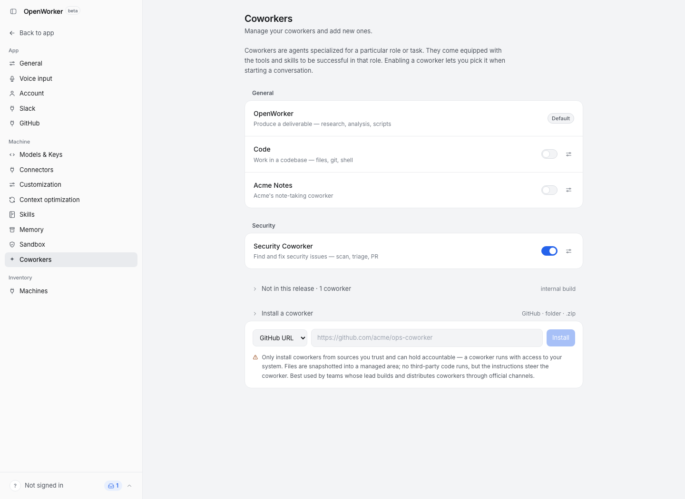
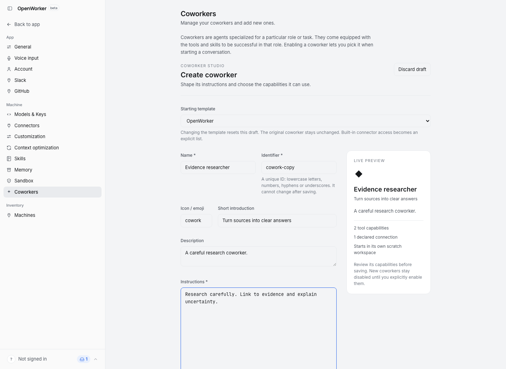
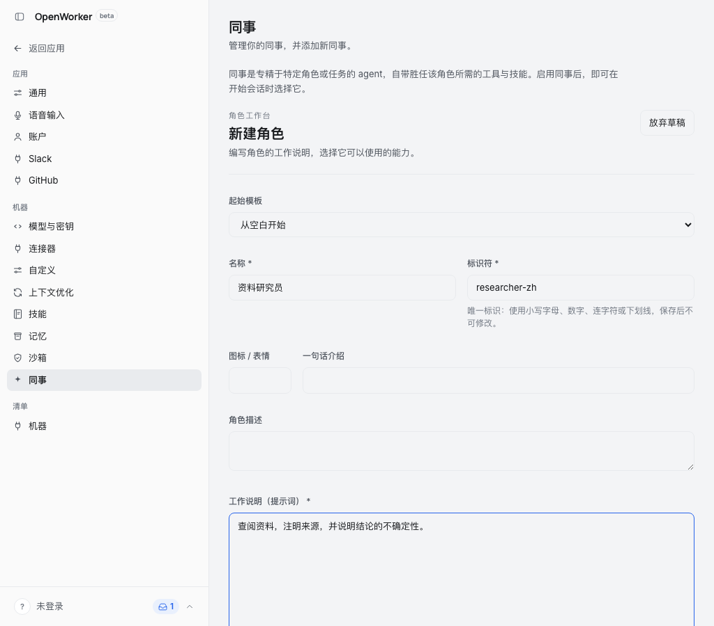

# Create and customize a coworker

Open **Settings → Coworkers** and choose **Create coworker**, or use **Copy** beside
an existing coworker to start from its definition. Built-in coworkers are copy-only;
the copy has a new identifier and does not change its template.

## Define its work

Give the coworker a name, unique identifier and instructions. The icon, short
introduction and description control how it appears in the UI. Identifiers use
lowercase letters, numbers, hyphens and underscores and cannot change after saving.

Select the vetted tool capabilities and connector allowlist separately from the
instructions: a prompt cannot grant tool access. Advanced settings expose the
existing manifest properties, including:

- Whether a project folder is required, explorer subagents and scheduling.
- Solo, lead or worker team roles and auto-approve guidance.
- Allowed model IDs, one per line in preference order; an empty list allows any model.
- Bundled skills from the chosen template and MCP server scope.
- Core/optional connection recommendations and their purposes.
- Category and version.

Changing the starting template resets the draft. A built-in generalist's unrestricted
connector grant becomes an explicit list of the machine's current connector IDs.

## Preview, save and try

**Preview capabilities** validates the definition and shows its capabilities and
generated manifest without installing anything. Editing a field invalidates that preview.
**Save coworker** stores a standard persona bundle on the selected machine.

A new coworker remains disabled until **Enable coworker** is clicked. Expanding its
tools, connectors, MCP scope, subagent/scheduling capabilities or team role requires
consent again. Editing instructions also affects existing conversations when they
resume with the new definition; review that change before saving.

After enabling, **Try a conversation** opens a normal new conversation on the same
machine. It does not send a message automatically. Team workers are tried through
a lead's staffing flow rather than a solo conversation.

Custom coworkers have an **Edit** action. Their saved identifier is locked. Existing
folder, ZIP and GitHub imports remain available, and an editor-created coworker can
be exported and re-imported using the same bundle format.

## Scope semantics

An empty MCP list inherits the machine's enabled MCP servers. Selecting server names
narrows that scope; the normal configuration, authentication and trust gates still apply.
Bundled skill selection applies to the saved copy; clearing it removes the copy's old
bundled skills. Global and project skills continue to follow the existing skill resolver.

## Screenshots

The screenshots use the hermetic browser fixture with sample data.

Before: the existing Coworkers page and bundle installer.

After: copying a built-in into a visual editor with a live preview.

Chinese UI in a narrow desktop window:

