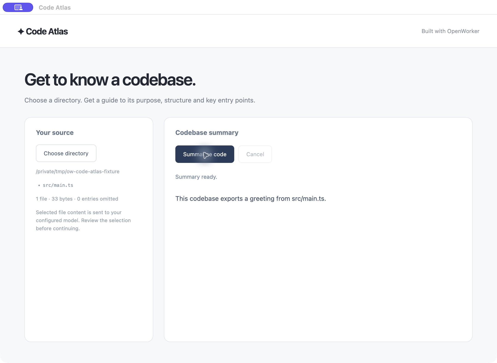
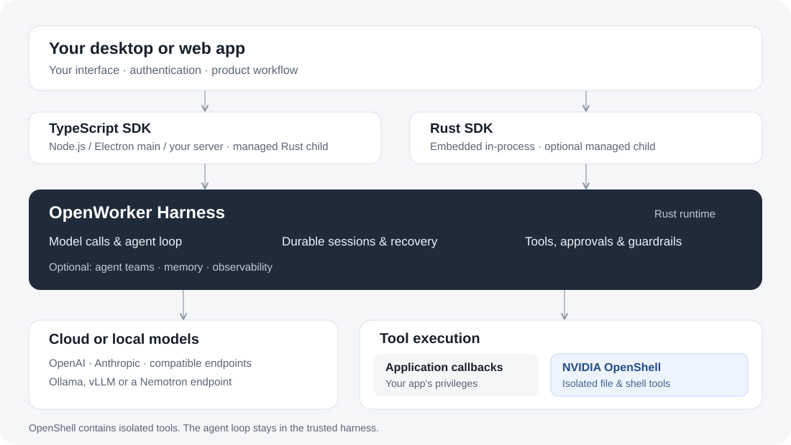

<h1 align="center">OpenWorker Harness SDK</h1>

<p align="center"><strong>Build your app. OpenWorker handles the agents.</strong></p>

Build a document assistant, a file-organizing utility or a coding app with agents that can use tools and work together. Keep your interface and product workflow; OpenWorker manages the agent loop, model calls, approvals and durable sessions.

<p align="center"><a href="#build-your-first-agent">Get started</a> · <a href="https://openworker.com/docs/sdk/">Documentation</a> · <a href="#build-with-your-coding-agent">Builder skill</a> · <a href="#choose-an-example-app">Example apps</a></p>

> **Under active development.** Please try the SDK and [open issues](https://github.com/andrewyng/openworker/issues) for bugs and feature requests. Please hold off on SDK pull requests while the API is evolving.

## Build your first agent

Use the code below, or [build with your coding agent](#build-with-your-coding-agent). You can start locally without a service cluster.

### Write the code yourself

Requires Node.js 20+ with ESM. npm includes the matching native runtime; no Rust compiler or Python installation is needed.

```sh
npm install --save-exact @openworkerai/harness-sdk@0.1.0-beta.4
```

Save this as `agent.mjs`. It connects a model, creates an agent and runs its first request:

```typescript
import { resolve } from 'node:path';
import { Harness } from '@openworkerai/harness-sdk';

const model = process.env.OPENWORKER_MODEL;
if (!model) throw new Error('Set OPENWORKER_MODEL');
const harness = await Harness.start({
  stateDir: resolve('.openworker-state'), sandbox: 'off',
});
try {
  await harness.setModelProvider({
    name: 'OpenAI', api: 'responses',
    baseUrl: process.env.OPENWORKER_MODEL_URL ?? 'https://api.openai.com/v1',
    credentials: { apiKeyEnv: 'OPENAI_API_KEY', storage: 'memory' },
  });
  const agent = harness.createAgent({
    name: 'first-agent-v1', instructions: 'Give concise, helpful answers.',
    defaultModel: { provider: 'OpenAI', name: model },
    tools: [], planning: false, memory: false, scheduling: false,
  });
  const session = await agent.newSession();
  const result = await session.run('Suggest three names for a file-organizing app.');
  if (result.status !== 'completed') throw new Error(`Run ended: ${result.status}`);
  console.log(result.finalOutput);
} finally {
  await harness.shutdown();
}
```

In a private env file outside your project, set `OPENAI_API_KEY` to your API key and `OPENWORKER_MODEL` to an exact model ID available to your account. Then run:

```sh
node --env-file=/path/to/private.env agent.mjs
```

The program prints the agent’s answer. `OPENWORKER_MODEL_URL` optionally selects another Responses-compatible endpoint. See [models and credentials](../docs/harness/guides/providers.md) for Anthropic, other providers and local models.

This first agent has no tools and explicitly disables sandboxing. When adding tools, choose their execution boundary: application callbacks retain your app’s privileges, and a workspace path alone does not confine filesystem access. Start with the [file-organizer example](../skills/openworker-harness-builder/references/local-script.md) for scoped tools and human approvals.

**Using Rust?** Follow the [complete Rust quickstart](harness-sdk/README.md) to embed the engine from a pinned checkout. It includes the current native-helper setup. The [TypeScript package README](typescript-sdk/README.md) covers application lifecycle and integration details.

<a id="build-with-codex-or-claude-code"></a>

### Build with your coding agent

Install the builder skill in your app project:

```sh
npx @openworkerai/openworker-harness-builder --agent claude --project .
```

Use `--agent codex` for Codex, or replace `--project .` with `--global` for all your projects. Open a new coding-agent session and give it a concrete task:

> Use the openworker-harness-builder skill to build a local file-organizing app. Start with ten sample text files in a new demo directory. Restrict its file tools to that directory, ask me before creating subdirectories or moving files, and show tool activity as the agent works. Run the tests and explain how to launch it.

The skill supplies SDK instructions and runnable examples; you do not need to clone this repository. See the [skill guide](../skills/README.md) for updates, replacement backups and the tested SDK version.

<a id="choose-your-starting-point"></a>
<a id="try-an-example"></a>

## Choose an example app

| Build | Example and source | What you’ll learn |
| --- | --- | --- |
| **Local utility** | [File organizer](../skills/openworker-harness-builder/references/local-script.md) · [Source](../skills/openworker-harness-builder/assets/local-script/) | Custom tools, directory restrictions, streaming and per-operation approvals. |
| **Desktop app** | [Code Atlas walkthrough](../docs/harness/guides/desktop.md) · [Source](examples/quickstart/desktop/main.mjs) · [Setup](examples/quickstart/README.md) | Select a code directory and stream an explanation in an Electron UI. |
| **Web app** | [PDF Notes walkthrough](../docs/harness/guides/server.md) · [Source](examples/quickstart/web/server.mjs) · [Setup](examples/quickstart/README.md#web-deployment) | Upload a text-based PDF and ask follow-up questions in its own session. |
| **Game builder** | [Arcade Studio](examples/arcade/README.md) · [Source](examples/arcade/) | Build and preview games, approve versions and return to a saved library. |

Code Atlas and PDF Notes share `examples/quickstart/`; they are two complete TypeScript apps. The file organizer is bundled with the skill. The checkout examples use the local SDK and need the runtime setup described in their READMEs.



*Code Atlas example UI, shown with deterministic test data.*

<a id="what-your-application-gains"></a>

## What the SDK handles for you

| Your application needs… | OpenWorker provides |
| --- | --- |
| **An agent that gets work done** | The model/tool loop, streaming, cancellation and context compaction. |
| **Conversations that survive restarts** | Durable sessions and explicit recovery without blindly replaying uncertain actions. |
| **People in control** | Human approvals, session grants and optional LLM-assisted review. [Approvals](../docs/harness/guides/sessions.md) |
| **Content and execution controls** | Guardrails and hooks, plus OpenShell isolation for configured tools. [Guardrails](../docs/harness/guides/guardrails.md) · [OpenShell](../docs/harness/guides/openshell.md) |
| **Agents that delegate** | Standalone sub-agents and teams with durable messages and boards. [Sessions and teams](../docs/harness/guides/sessions.md) |
| **A choice of models** | Cloud and local providers with application-owned credentials. [Models](../docs/harness/guides/providers.md) |
| **Visibility into each run** | Opt-in turn traces, token usage and telemetry export to tools such as Langfuse. [Observability](../docs/harness/guides/observability.md) |

<a id="your-app-and-the-harness"></a>

## How it fits into your app

Your app owns the UI, authentication and user/session ownership. It chooses the models, tools and policies. One Rust engine powers both SDKs: TypeScript manages it as a child process; Rust can embed it in-process. Browser code calls your application server or desktop IPC.



OpenShell isolates configured shell/file execution while the agent loop remains in the trusted harness. Application callbacks still run with your application’s privileges. See [execution boundaries](../docs/harness/guides/openshell.md).

The existing OpenWorker Desktop App uses its separate Python engine. This SDK provides the Rust engine for applications you build.

<a id="deployment-and-operations"></a>

## Deployment and observability

Start inside your desktop app, Node process or application container. A separate agent service is optional. Use it when you need API/worker separation, shared PostgreSQL storage and separately managed execution environments. Local apps can use SQLite.

- **Build and ship an app:** [Electron/Tauri starters](desktop-starters/README.md) · [Web deployment](../docs/harness/guides/server.md).
- **Run a shared service:** [Deployment choices](../docs/harness/guides/deployment.md) · [Local containers and Kubernetes](../deploy/service/README.md) · [Management CLI](service-cli/README.md).
- **Inspect agent activity:** [Turn traces, usage and export](../docs/harness/guides/observability.md) · [Service management UI](service-ui/README.md).
- **Explore cloud deployment:** [AWS](../docs/harness/guides/aws.md) · [Azure](../docs/harness/guides/azure.md) · [GCP](../docs/harness/guides/gcp.md) · [Private Kubernetes](../docs/harness/guides/private-kubernetes.md).

Observability is optional for lightweight applications. Cloud deployment paths are experimental references; qualify your configuration in the target environment before production use.

## Documentation

| Next step | Guide |
| --- | --- |
| Add custom tools or MCP servers | [Tools and MCP](../docs/harness/guides/tools.md) |
| Stream responses and handle approval cards | [Streaming and approval loop](../docs/harness/guides/streaming.md#streaming-with-tool-approvals) |
| Accept images, PDFs and text files | [Attachments](../docs/harness/guides/attachments.md) |
| Configure safety and audit controls | [Alignment](../docs/harness/guides/alignment.md) · [Compliance](../docs/harness/guides/compliance.md) |
| Check versions or diagnose a problem | [Compatibility](../docs/harness/guides/releases.md) · [Troubleshooting](../docs/harness/guides/troubleshooting.md) |

## For developers and coding agents

Use the [TypeScript](typescript-sdk/README.md) or [Rust](harness-sdk/README.md) package README for the integration contract. The installed builder skill records its tested SDK pin in `references/installation.json`.

- Preserve immutable agent identities; changing instructions, tools or approvals requires a new name.
- Keep credentials and durable state outside model-readable files.
- Use real user decisions for human approval requests. Stopping observation does not cancel execution.
- Reconcile unknown tool outcomes before retrying.
- Prefer public SDK/service interfaces over runtime tables or private transport methods.

<details>
<summary>Versions and native runtime compatibility</summary>

The npm client **0.1.0-beta.4** uses native runtime **0.1.0-beta.3**. npm installs the matching platform package automatically; keep optional dependencies enabled. Source manifests and published package versions can differ. Follow the [release and compatibility guide](../docs/harness/guides/releases.md) when pinning or upgrading, rather than inferring registry availability from a source version string.

Rust applications currently use a pinned source checkout. See the [Rust quickstart](harness-sdk/README.md); npm publication does not imply Cargo registry publication.

</details>

Need to change the engine or register native tools? See the [native host guide](partner/README.md), [Tools SDK](tools-sdk/README.md) and [workspace CI](../.github/workflows/rust-sdk.yml).

<details>
<summary>Build and test this checkout</summary>

Use the [pinned toolchain](rust-toolchain.toml), Node.js and your platform's native
prerequisites. See [Windows build notes](WINDOWS.md) when applicable.

```sh
cd harness
cargo build --release --locked -p openworker-sdk --bin openworker-harness
npm --prefix typescript-sdk ci
npm --prefix typescript-sdk run build
```

The host is `target/release/openworker-harness` (`.exe` on Windows). Build a custom
SDK/helper pair from the same revision; npm consumers normally use the packaged runtime.

```sh
cargo fmt --all -- --check
cargo test --locked -p openworker-sdk --features test-support --test provider_auth
npm --prefix typescript-sdk test
```

OpenShell, PostgreSQL and live-provider checks require their documented setup.
The [documentation site](../docs-site/README.md) is built from repository Markdown.

</details>

[MIT license](../LICENSE).
